# DocIndex: Local Document Indexing and Search Engine

A CSC2104 Object Oriented Programming mini project (project 25) by **Chirag Shah**, Reg. No. 2503080249, Section T4.

Point it at a folder of text files. It reads them once, builds an index, and then answers searches by ranking every matching file by how often your words appear in it. The engine is plain Java. A website sits on top of it, and the website also runs on its own in the browser, so it can be hosted on Vercel.

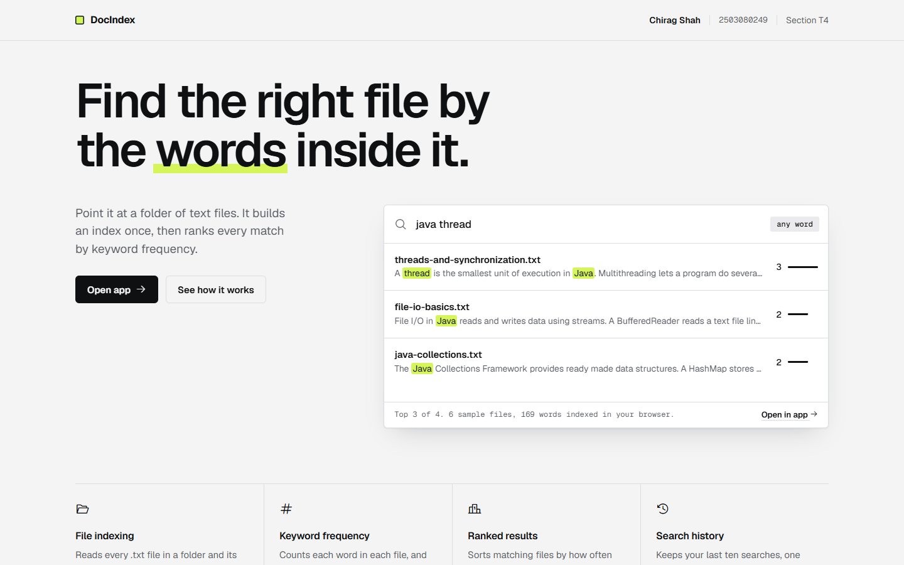

## Contents

- [What it does](#what-it-does)
- [Screenshots](#screenshots)
- [Try it](#try-it)
- [How it works](#how-it-works)
- [Class design](#class-design)
- [Semantic search and LLM integration](#semantic-search-and-llm-integration)
- [Course topics](#course-topics)
- [What is in the repository](#what-is-in-the-repository)
- [Tests](#tests)
- [Put the website online](#put-the-website-online)

## What it does

The four features from the project brief, and where to see each one:

| Feature | What you see | Java that does it |
|---|---|---|
| **File indexing** | Index a folder (by path with the Java engine, or by picking or dropping it in the browser). The panel shows how many files and different words were indexed. | `DocumentLoader`, `Tokenizer`, `InvertedIndex` |
| **Keyword frequency** | Each result says how often each word appears in it (`java ×1 + thread ×2`), and the **Most frequent words** list ranks the words of the whole index. | `InvertedIndex.countsFor`, `InvertedIndex.topWords`, `WordCount` |
| **Ranked results** | Files sorted by score, best first, with a snippet and a bar per result. Click a file name to read it with every match highlighted. | `SearchEngine`, `SearchResult`, `PriorityQueue` |
| **Search history** | The last 10 searches, newest first. Click one to run it again. | `SearchHistory`, `HistoryEntry`, `LinkedList` |

Searches can ask for files that contain **all** the words or **any** of them.

The title's two extra parts use Google's Gemini, and only with the Java engine (see [Semantic search and LLM integration](#semantic-search-and-llm-integration)):

| Feature | What you see | Java that does it |
|---|---|---|
| **Semantic search** | Turn on **Smart search**: Gemini adds up to 5 related words (`concurrency` also finds `thread`, `deadlock`), and the same engine ranks the files. | `QueryExpander` |
| **LLM answers** | **Ask your notes**: the engine finds the 3 best files, and Gemini answers from those files only, naming them as sources. | `AnswerGenerator`, `Answer` |

## Screenshots

| Ranked results and keyword frequency | Document view |
|---|---|
| 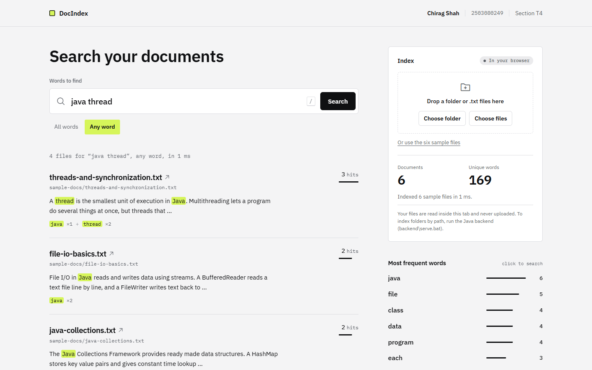 | 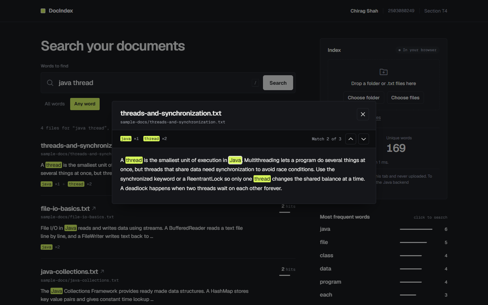 |

<p align="center">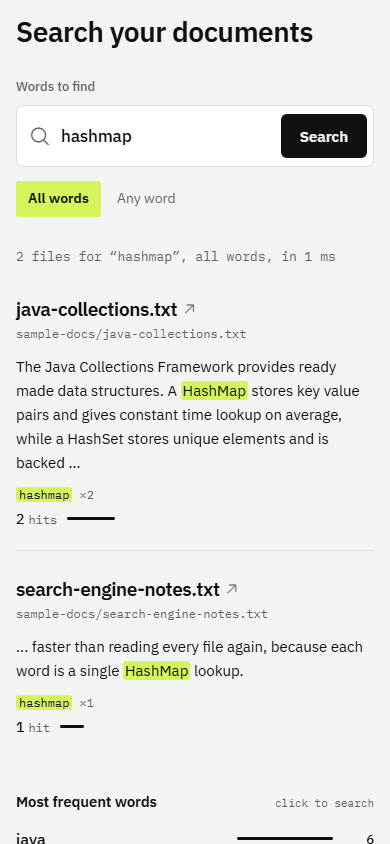</p>

## Try it

| I want to | Run | Then |
|---|---|---|
| Use the website with the Java engine | `backend\serve.bat` | Open http://localhost:8080 |
| Use the console menu | `backend\run.bat` | Follow the menu |
| Run the tests | `backend\test.bat` | Expect `108 passed, 0 failed` |
| Try the website with no Java | `python -m http.server 5173` in `frontend` | Open http://localhost:5173 |

The Java parts need a JDK (IntelliJ ships one: set `JAVA_HOME` to it). A plain Java runtime cannot compile.

In the app, press **Use the sample files** to index the six sample files, then search for `java thread`. Without the Java engine you can also index your own notes: press **Choose folder**, or drop a folder on the page. The files are read inside your browser and never uploaded.

## How it works

### The big picture

The website talks to one file, `api.js`, which decides who answers. When the Java backend is running, every request goes to it. Otherwise the same steps run in `engine.js`, a JavaScript copy of the Java classes, so the website still works on a static host.

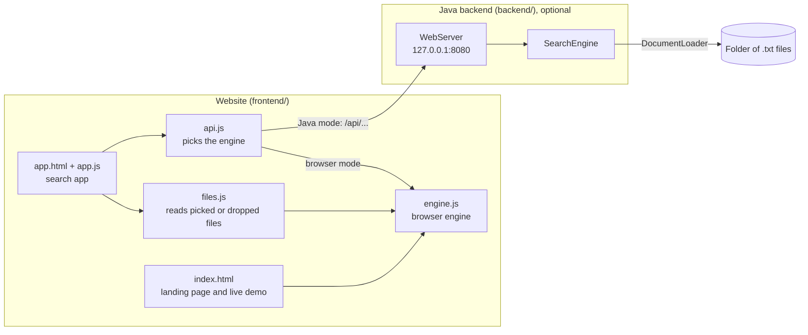

### 1. Indexing: from a folder to an index

Indexing happens once. Every file is read, split into words, and each word is recorded with the files it appears in and how many times.

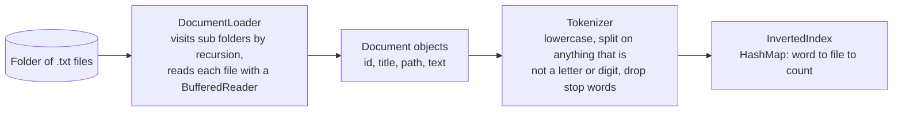

`"A Thread is the smallest unit!"` becomes `[thread, smallest, unit]`: the words "a", "is" and "the" are in the stop word `HashSet`, so they are dropped.

### 2. The inverted index

The index works like the one at the back of a book: look a word up and it tells you where it appears. This is part of it for the six sample files.

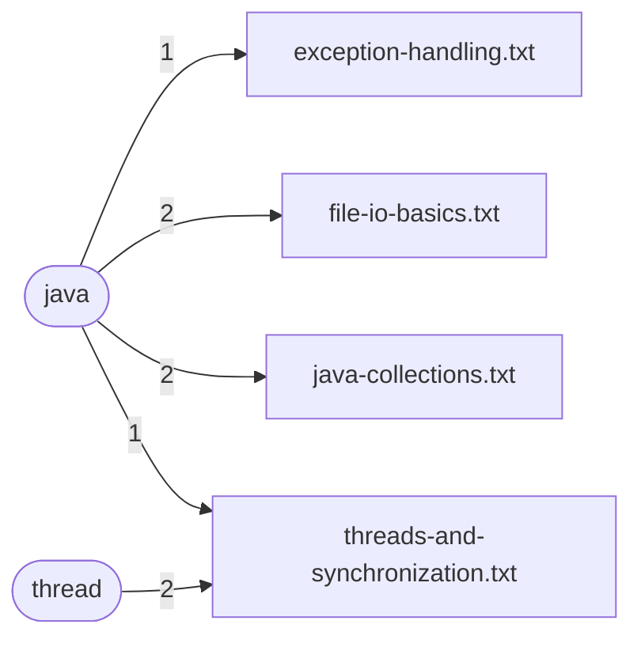

In Java this is `HashMap<String, Map<Integer, Integer>>`: the word, then the document id, then the count. Finding every file that contains a word is a single lookup, however many files there are.

### 3. Searching: all words or any word

Each search word gives a set of files. **All words** keeps the files that are in every set (intersection), **any word** keeps the files that are in at least one (union). `AllWordsMatcher` and `AnyWordMatcher` are two subclasses of the abstract `Matcher`, and the engine does not need to know which one it has.

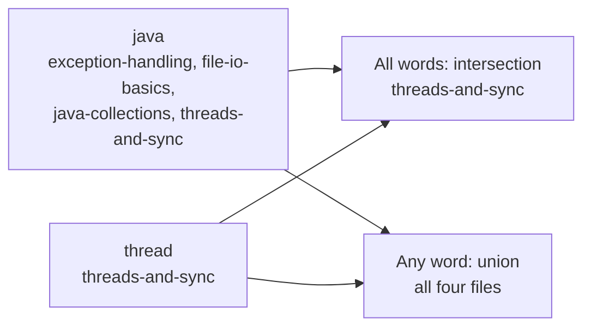

### 4. Ranking: keyword frequency as the score

A file's score is the total number of times the search words appear in it. Results go into a `PriorityQueue`, and `SearchResult` implements `Comparable`, so the queue always hands back the best result first. Equal scores are ordered by file name.

| `java thread`, any word | java | thread | Score |
|---|---|---|---|
| threads-and-synchronization.txt | 1 | 2 | **3** |
| file-io-basics.txt | 2 | 0 | **2** |
| java-collections.txt | 2 | 0 | **2** |
| exception-handling.txt | 1 | 0 | **1** |

### 5. One search from start to finish

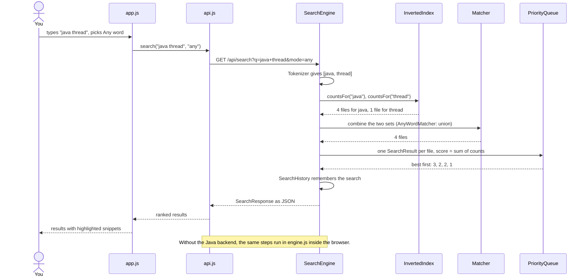

### 6. Which engine answers

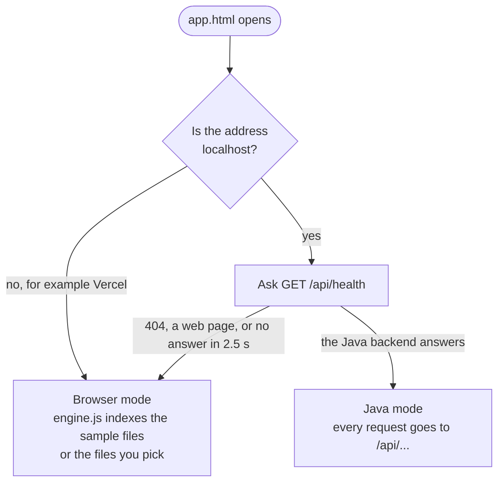

## Class design

All Java classes are in the package `docsearch`. The diagrams show the important fields and methods.

### How the classes work together

`SearchEngine` is in the middle: it uses `DocumentLoader` to read a folder, owns the `InvertedIndex` and the `SearchHistory`, and is used by both the console menu (`Main`) and the `WebServer`.

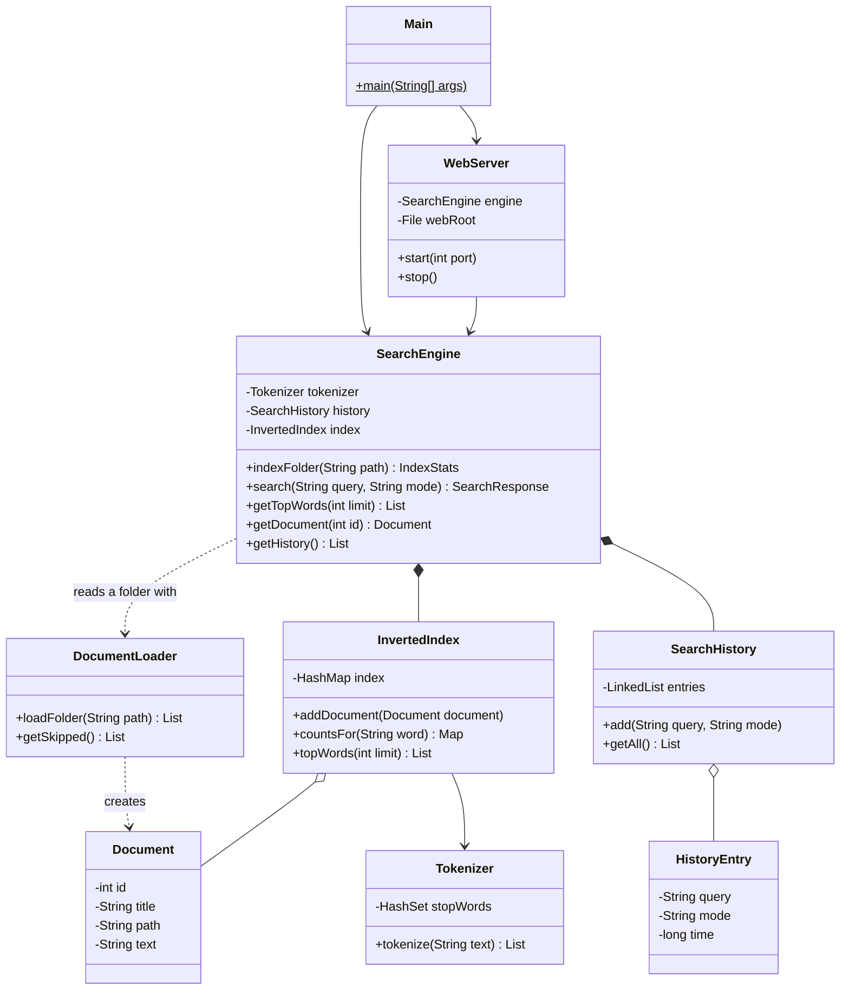

### Inheritance and interfaces

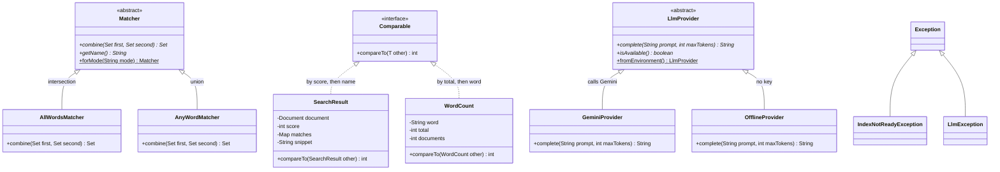

The other classes are small helpers: `SnippetBuilder` cuts the text around the first match, `Json` turns answers into JSON for the website, and `IndexStats`, `SearchResponse` and `Answer` carry answers back to the caller. `QueryExpander` and `AnswerGenerator` use an `LlmProvider` without knowing which one it is. [backend/README.md](backend/README.md) has a table of every class.

## Semantic search and LLM integration

Gemini sits on top of the search engine and never replaces it: the engine still reads, indexes and ranks every file. Gemini is used as little as possible:

- **At most one call per new smart search or question.** Answers and suggested words are remembered in a `HashMap`, so asking again is free.
- **No call at all** when no file matches, when the words are all stop words, or when no key is set.
- **Small prompts:** a question sends only the 3 best files, about 600 characters from each, and asks for at most 80 words back.
- **Never during indexing**, and the app shows how many calls have been made.

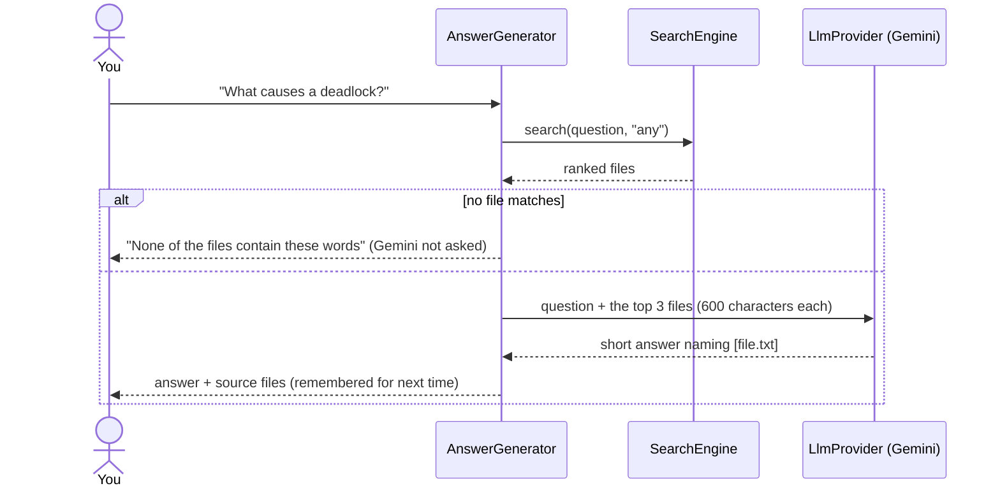

To turn it on, set your Gemini API key before starting the Java engine. The key stays on your computer and is never written in the code:

```bat
set GEMINI_API_KEY=your-key-here
backend\serve.bat
```

The model is `gemini-3.8-flash`; set `GEMINI_MODEL` to use another. Without a key everything else still works: smart search becomes a normal search, and a question lists the best matching files. The Vercel site has no Java engine, so these two features are switched off there.

## Course topics

| Topic | Where it is used |
|---|---|
| Classes, objects and encapsulation | `Document`, `SearchResult`, `WordCount`, `IndexStats` and others: private fields, getters only |
| Inheritance, abstract classes, polymorphism | `Matcher` with `AllWordsMatcher` and `AnyWordMatcher`; `LlmProvider` with `GeminiProvider` and `OfflineProvider` |
| Method overloading | `SnippetBuilder.build` (default size, or a chosen size for the LLM), `Json.searchResponse` |
| Nested classes | `SelfTest.FakeProvider`, a stand-in for Gemini in the tests |
| Interfaces: `Comparable` | `SearchResult` (by score) and `WordCount` (by total) know their own order |
| `HashMap` | `InvertedIndex`: word to file to count |
| `HashSet` | Stop words in `Tokenizer`, and the file sets the matchers combine |
| `PriorityQueue` | Ranking results in `SearchEngine`, and the most frequent words in `InvertedIndex` |
| `LinkedList` | `SearchHistory` |
| File I/O and recursion | `DocumentLoader`: `File.listFiles`, `BufferedReader`, a method that calls itself for sub folders |
| Strings and `StringBuilder` | `Tokenizer`, `SnippetBuilder`, `Json` |
| Exception handling | `IndexNotReadyException` and `LlmException` (custom checked exceptions), and try/catch/finally around file reading |
| `Scanner` | The console menu in `Main` |

Two classes go outside the course, and both only pass messages along: `WebServer` uses the `HttpServer` that comes with Java so the browser can talk to the engine, and `GeminiProvider` uses `HttpURLConnection` to send a prompt to Gemini.

## What is in the repository

```
backend/            the Java engine, console menu and web server (see backend/README.md)
  src/docsearch/      the classes
  sample-docs/        six short text files to try it on
  build.bat run.bat serve.bat test.bat
frontend/           the website (see frontend/README.md)
  index.html          landing page with a live demo
  app.html            the search app
  js/engine.js        the browser engine, a JavaScript copy of the Java classes
  js/api.js           decides whether the browser or the Java backend answers
docs/screenshots/   the pictures in this README
```

## Tests

`backend\test.bat` builds the project and runs `SelfTest`, which prints `PASS` or `FAIL` for 108 checks: the tokenizer, the loader, the index and its top words, both matchers, ranking, snippets, history, the engine end to end, the JSON the web server sends, and the Gemini layer. The Gemini checks use a fake provider and a small fake Gemini server on your own computer, so they need no key and no internet. No test framework is needed.

The sample files give the same answers in both engines, which the tests and the frontend rely on: 6 documents, 169 different words, `java thread` with any word gives scores 3, 2, 2, 1, and the most frequent word is `java` (6 times in 4 files).

## Put the website online

The website is plain static files with no build step, so it can be hosted on Vercel:

1. On vercel.com choose **Add New, Project** and import this repository.
2. Set **Framework Preset** to `Other` and **Root Directory** to `frontend`.
3. Leave the build settings empty and deploy.

Vercel cannot run the Java server, so the hosted site runs in browser mode: visitors can index the sample files or their own folder, with nothing uploaded. More detail is in [frontend/README.md](frontend/README.md).

## License

MIT. See [LICENSE](LICENSE).
