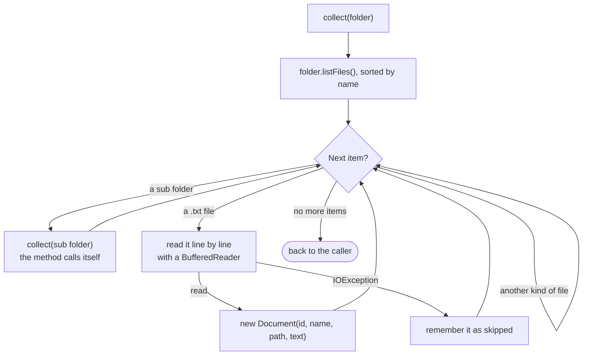
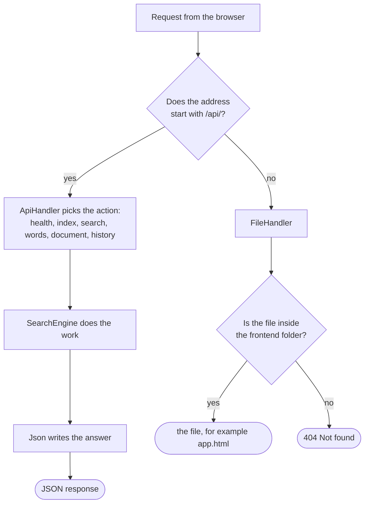

# Backend (Java)

The search engine itself, written in plain Java with no libraries and no build tool. It reads a folder of text files, builds an index, and answers searches with ranked results. The diagrams of how the classes fit together are in the [main README](../README.md#class-design).

## Build, test and run

You need a JDK (a JRE alone cannot compile). If you use IntelliJ, it ships one. Point `JAVA_HOME` at a JDK, or put `javac` on your `PATH`, then:

```bat
cd backend
test.bat      rem build, then run the self test
run.bat       rem build, then start the console menu
serve.bat     rem build, then start the web server and the frontend (http://localhost:8080)
```

`build.bat` only compiles into `out/`. The classes are built for Java 8, so they run on older and newer Java alike.

To use an IDE instead, open the `backend` folder in IntelliJ and mark `src` as the Sources Root. Run `docsearch.Main` for the menu and `docsearch.SelfTest` for the tests, with `backend` as the working directory so `sample-docs` is found.

## The console menu

```
1. Index a folder
2. Search
3. Ask a question about your notes
4. Show the most frequent words
5. Show search history
6. Clear search history
7. Exit
```

Choose 1 and press Enter to index the `sample-docs` folder, then choose 2 and type some words. You can ask for files that contain **all** the words, **any** of them, or use **smart search** (Gemini adds related words). Option 3 answers a question from your notes with Gemini; both need `GEMINI_API_KEY` (see below). Option 4 lists the words that appear most often across all the files:

```
The 10 most frequent words:
1. java   6 times in 4 file(s)
2. file   5 times in 2 file(s)
3. class   4 times in 2 file(s)
...
```

## How a search works

1. **Index (once):** `DocumentLoader` reads every `.txt` file. `Tokenizer` splits each file into lowercase words and drops filler words. `InvertedIndex` records, for every word, which files contain it and how many times.
2. **Look up:** for each word you typed, the index gives the set of files that contain it.
3. **Combine:** a `Matcher` merges those sets. `AllWordsMatcher` keeps files that are in every set (intersection). `AnyWordMatcher` keeps files that are in at least one (union).
4. **Score:** a file's score is the total number of times your words appear in it.
5. **Rank:** results go into a `PriorityQueue` that always hands back the best one first. Equal scores are ordered by file name.
6. **Remember:** the search is added to the history, which keeps the last 10.

**Keyword frequency** across the whole index works the same way: `InvertedIndex.topWords` adds up each word's counts, wraps each word in a `WordCount`, and a `PriorityQueue` hands back the most frequent first.

### Reading a folder: recursion

`DocumentLoader.collect` handles one folder. When it meets a sub folder, it calls itself for that folder, so folders of any depth are read.



The reader is closed in a `finally` block, so a file is closed even when reading it fails.

## The web server

`serve.bat` starts a small web server and prints `DocSearch is running at http://localhost:8080`. Open that address and you get the website, backed by this engine, which can index any folder on your computer. Use `serve.bat 9000` to pick another port.

The server is the postman between the browser and the engine. The browser sends a request, `WebServer` passes it to `SearchEngine`, and `Json` writes the answer:



| Request | What it does |
|---|---|
| `GET /api/health` | Says the engine is running, and what is indexed. The frontend uses it to find the backend. |
| `POST /api/index` | Indexes the folder named in the request |
| `GET /api/search?q=java+thread&mode=any` | Searches, with `mode` set to `all` or `any` |
| `GET /api/words?limit=10` | The most frequent words in the index |
| `GET /api/document?id=6` | One whole document, so the website can show it with the matches highlighted |
| `GET /api/search?q=concurrency&smart=1` | Smart search: Gemini adds related words, then the engine searches for any of them |
| `GET /api/ask?q=what+is+a+deadlock` | Answers a question from the 3 best matching files, with the files as sources |
| `GET /api/history` | Returns the last 10 searches |
| `DELETE /api/history` | Clears the history |

Any other address returns a file from the `frontend` folder. Each answer's exact shape and the error codes are listed in [frontend/README.md](../frontend/README.md#api).

`WebServer` uses the `HttpServer` that comes with Java, so there is still nothing to install. Along with `GeminiProvider`, it is outside the course topics, and both only pass messages along: all the searching is done by the classes below. Two safety choices are built in. It listens on `127.0.0.1`, so only your own computer can connect, and it refuses any file address that would leave the `frontend` folder.

## The classes

All classes are in the package `docsearch`.

| Class | What it does | Course topic |
|---|---|---|
| `Document` | One text file: id, name, path and text | Encapsulation (private fields, getters) |
| `Tokenizer` | Lowercases text, splits it into words, drops filler words like "the" | Strings, `HashSet` |
| `DocumentLoader` | Reads every `.txt` file in a folder and its sub folders | File I/O, recursion, try/finally |
| `InvertedIndex` | Maps each word to the documents containing it and how many times, and finds the most frequent words | `HashMap`, `PriorityQueue` |
| `Matcher`, `AllWordsMatcher`, `AnyWordMatcher` | Combine the document sets of the search words | Abstract class, inheritance, polymorphism, `HashSet` |
| `SearchResult` | One result row. It can compare itself with another by score | `Comparable` |
| `WordCount` | One word's total count across the index. It compares by total | `Comparable` |
| `SnippetBuilder` | Cuts a short piece of text around the first match | Strings |
| `SearchEngine` | Indexes a folder, runs a search, ranks the results, gives the top words | `PriorityQueue`, Collections |
| `SearchHistory`, `HistoryEntry` | Remember the last 10 searches, newest first | `LinkedList` |
| `IndexNotReadyException` | Raised if you search before indexing | Custom exception |
| `IndexStats`, `SearchResponse` | Small classes that carry answers back to the caller | Encapsulation |
| `Json` | Writes the engine's answers as JSON text and reads one value from a request or a Gemini reply | Strings, `StringBuilder`, method overloading |
| `LlmProvider`, `GeminiProvider`, `OfflineProvider` | Send a prompt to Gemini, or refuse when no key is set; every call is counted | Abstract class, inheritance, polymorphism; `HttpURLConnection` (outside the course) |
| `QueryExpander` | Smart search: asks Gemini once per query for up to 5 related words | `HashMap` (remembers each answer) |
| `AnswerGenerator`, `Answer` | Ask your notes: the engine finds the 3 best files, Gemini answers from them only | `HashMap`, encapsulation |
| `LlmException` | Raised when Gemini cannot answer: no key, no internet, a wrong key | Custom exception |
| `WebServer` | Lets the browser use the engine over HTTP, and serves the frontend files | The `HttpServer` that comes with Java (the only non-course topic) |
| `Main` | Starts the console menu, or the web server when given `web` | `Scanner` |
| `SelfTest` | Prints PASS or FAIL for each behaviour | Plain `main` method |

## Sample documents

`sample-docs/` holds six short files. They are the same texts the website uses in browser mode, so the Java engine and the browser engine give the same answers. For example, searching `java thread` for **any** word returns four files with scores 3, 2, 2 and 1, and the most frequent word is `java`, 6 times in 4 files. The self test checks this.

## Tests

`test.bat` runs 108 checks: the tokenizer, the loader, the index and its top words, both matchers, ranking of results and of word counts, snippets, history, the engine end to end, the JSON the web server sends, and the Gemini layer (with a fake provider and a fake Gemini server, so no key or internet is needed).

## Gemini (smart search and questions)

Set your key in the same window before starting, so it never appears in the code:

```bat
set GEMINI_API_KEY=your-key-here
serve.bat
```

`GEMINI_MODEL` picks another model (the default is `gemini-3.8-flash`). Each call asks for little thinking and a short reply, every answer is remembered, and nothing is sent when no file matches. Without a key, smart search is a normal search and a question lists the best files. The web server itself was checked by hand against every address, including error cases and attempts to read files outside the frontend folder.
