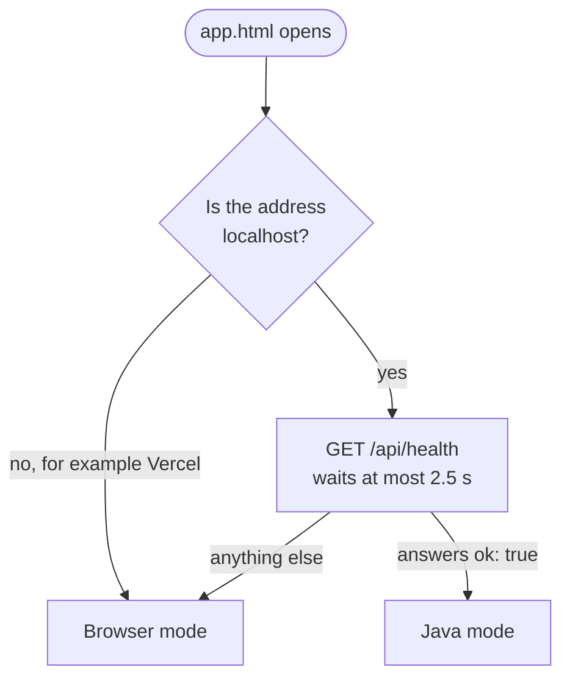
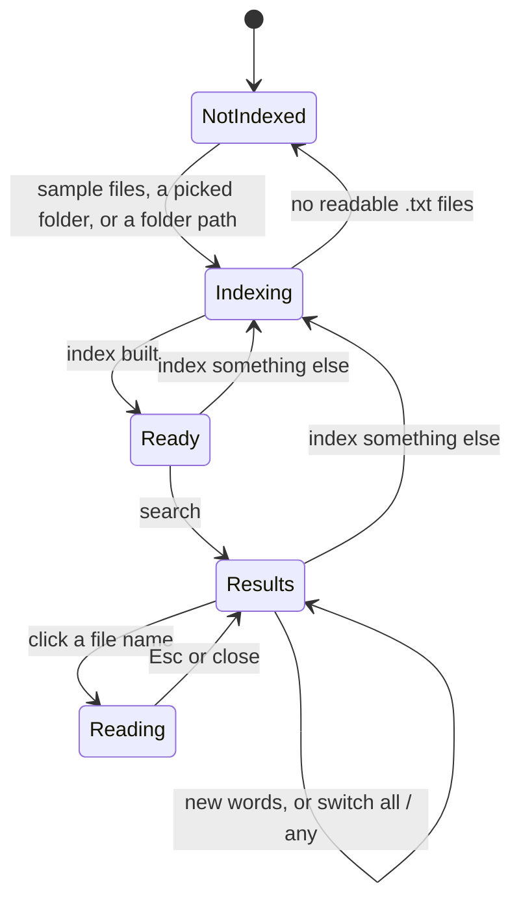
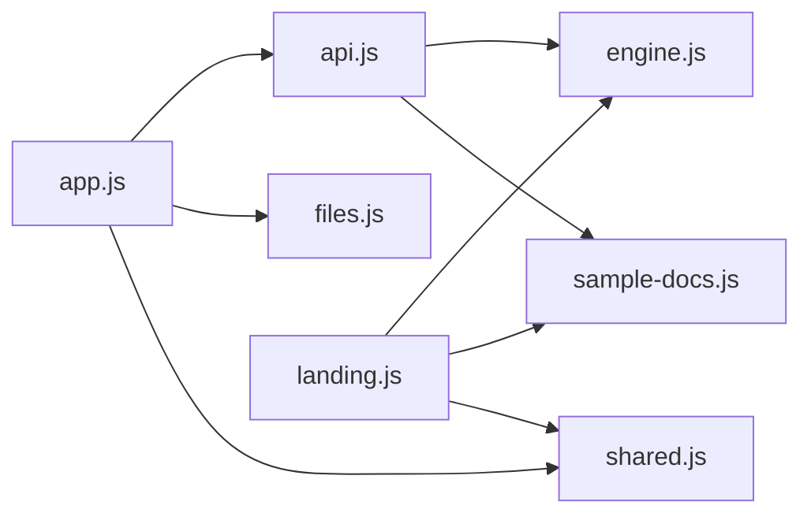

# DocIndex frontend

The website for the Local Document Indexing and Search Engine (CSC2104, Object Oriented Programming mini project).

Plain HTML, CSS and JavaScript. There is no build step, so any static host can serve this folder, and the Java backend serves it too.

## Run it

**With the Java engine** (indexes any folder on your computer by its path):

```bat
cd backend
serve.bat
```

Open http://localhost:8080. The page finds the backend by itself, and the Index panel shows a **Java engine** badge.

**Without Java** (everything runs in the browser):

```bash
cd frontend
python -m http.server 5173
```

Open http://localhost:5173. The Index panel shows an **In your browser** badge.

The first load needs an internet connection for the fonts and icons (see Credits).

## Pages

| File | What it is |
|---|---|
| `index.html` | Landing page. The search box in the hero is a working search of the sample files. **Open in app** carries that search over to the app. |
| `app.html` | The search app: index files, search them, see ranked results, the most frequent words and the history, and open a file to read it with every match highlighted. |

## Two engines, one website

`js/api.js` decides by itself who answers:



| | Browser mode | Java mode |
|---|---|---|
| Who answers | `js/engine.js`, inside the tab | The Java backend, through `/api/...` |
| What you can index | The six sample files, or a folder or files you pick or drop. Only `.txt` files are read, sub folders included. | Any folder you type the path of, or `sample-docs` |
| Where the history lives | This browser (`localStorage`) | The Java engine, until it stops |
| Uploads | None. Files are read in the tab and stay there. | None. The server only listens on this computer. |

`engine.js` follows the Java classes rule for rule (`Tokenizer`, `SnippetBuilder`, `InvertedIndex`, `SearchEngine`), so both engines give the same answers: 6 documents and 169 words for the sample files, scores 3, 2, 2, 1 for `java thread` with any word, and the same most frequent words.

To force one mode while developing, set `FORCE_MODE` at the top of `js/api.js` to `"browser"` or `"java"`.

## Using the app



- **Index:** press **Choose folder** or **Choose files**, drop a folder anywhere on the page, or use the sample files. With the Java engine, type a folder path instead. The panel shows the number of documents and different words.
- **Search:** type words and pick **All words** or **Any word**. Switching the mode re-runs the search. Each result shows how its score adds up, for example `java ×1 + thread ×2`. Long lists show 50 results at a time, with a button for the next 50.
- **Most frequent words:** the words that appear most often in the whole index (keyword frequency). Click one to search for it.
- **Read a file:** click a result's name. Every match is highlighted; **n** (or the arrow buttons) jumps to the next match, **Shift+n** to the previous one, **Esc** closes it.
- **History:** the last 10 searches, newest first. Click one to run it again.
- **Links:** a search is kept in the address, for example `app.html?q=java+thread&mode=any`. Opening such a link fills in the search and runs it as soon as something is indexed.
- **Keyboard:** **/** jumps to the search box.

## Structure

```
index.html         landing page
app.html           search app
favicon.svg
css/base.css       tokens, type, nav, buttons, footer, motion rules (shared)
css/landing.css    landing page
css/app.css        search app, document view, drop zone
js/shared.js       small helpers: escaping, highlighting, count-up
js/engine.js       the browser engine, a copy of the Java classes
js/files.js        reads picked or dropped .txt files, sub folders included
js/sample-docs.js  the six sample documents (same text as backend/sample-docs)
js/api.js          the only file that talks to an engine
js/landing.js      scroll reveals and the hero demo
js/app.js          indexing, searching, results, document view, top words, history
```

How the scripts depend on each other (an arrow means "uses"):



## API

These are the endpoints the Java backend implements. All answers are JSON.

| Request | Body or query | Response |
|---|---|---|
| `GET /api/health` | none | `{ "ok": true, "index": null }`, or the index stats below once something is indexed |
| `POST /api/index` | `{ "path": "C:\\notes" }` | `{ "path", "documents", "terms", "tookMs", "skipped" }` |
| `GET /api/search` | `q` (text), `mode` (`all` or `any`) | see below |
| `GET /api/words` | `limit` (1 to 100, default 10) | `[ { "word", "total", "documents" } ]`, most frequent first |
| `GET /api/document` | `id` (a result's `id`) | `{ "id", "title", "path", "text" }` |
| `GET /api/history` | none | `[ { "query", "mode", "at" } ]`, newest first, at most 10 |
| `DELETE /api/history` | none | `204 No Content` |

Search response:

```json
{
  "query": "java thread",
  "mode": "any",
  "terms": ["java", "thread"],
  "total": 4,
  "tookMs": 2,
  "results": [
    {
      "id": 6,
      "title": "threads-and-synchronization.txt",
      "path": "sample-docs/threads-and-synchronization.txt",
      "score": 3,
      "matches": { "java": 1, "thread": 2 },
      "snippet": "A thread is the smallest unit of execution in Java. ..."
    }
  ]
}
```

- `terms` is the query after tokenizing and removing stop words. The UI uses it to highlight matches, so the engine's tokenizer decides what gets highlighted.
- `score` is the sum of `matches`. Results come back sorted by `score`, highest first, and equal scores are ordered by file name.
- `mode: "all"` returns files containing every term (set intersection). `mode: "any"` returns files containing at least one (set union).
- `total` in `/api/words` is how many times the word appears in all files together; `documents` is how many files contain it.
- `skipped` is how many files could not be read while indexing.
- The backend records history itself when it handles a search.

Errors are `{ "error": "message", "code": "CODE" }` with a non-2xx status:

| Code | Status | Meaning |
|---|---|---|
| `NOT_INDEXED` | 409 | A search, word list or document came before any folder was indexed. The app asks the user to index first. |
| `BAD_PATH` | 400 | The folder path is missing or is not a folder. |
| `EMPTY_QUERY` | 400 | The search had no words. |
| `BAD_ID` | 400 | The document id is not a number. |
| `NOT_FOUND` | 404 | No such address, or no document with that id. |
| `METHOD_NOT_ALLOWED` | 405 | The address does not accept that kind of request. |
| `SERVER_ERROR` | 500 | Something unexpected went wrong. |

## Host it on Vercel

Vercel hosts static files, so the deployed site runs in browser mode. It cannot run the Java server.

1. Push the repository to GitHub.
2. On vercel.com choose **Add New, Project** and import the repository.
3. Set **Framework Preset** to `Other` and **Root Directory** to `frontend`.
4. Leave **Build Command** and **Output Directory** empty, then deploy.

No `vercel.json` is needed. The landing page opens first, and **Open app** leads into the search app. On the hosted site the app makes no request to `/api`, because the address is not `localhost`.

## Design notes

- One accent, a highlighter lime, used only as a background behind dark text.
- Light and dark themes follow the system setting.
- Motion only animates `transform` and `opacity`, and switches off under `prefers-reduced-motion`.
- Works down to phone width; on a phone the Index panel comes first.

## Credits

- Geist and Geist Mono (SIL Open Font License), loaded from Google Fonts.
- Phosphor Icons (MIT), loaded from unpkg.
